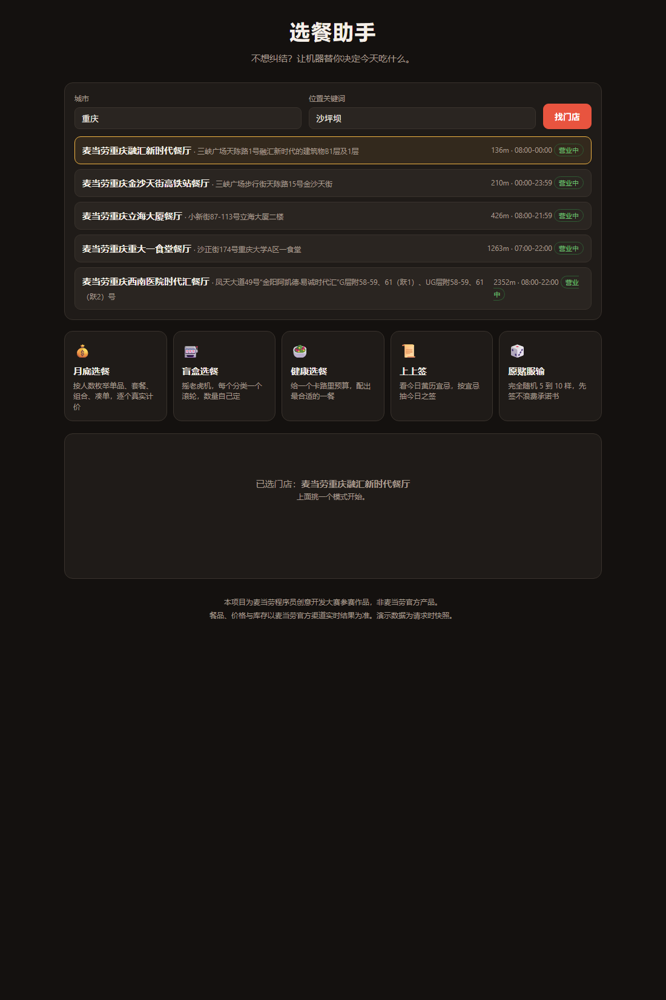
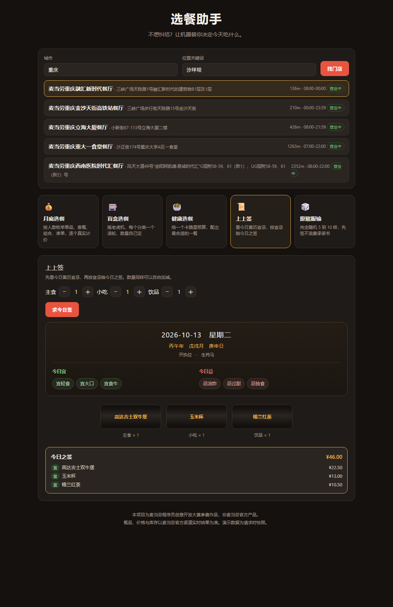
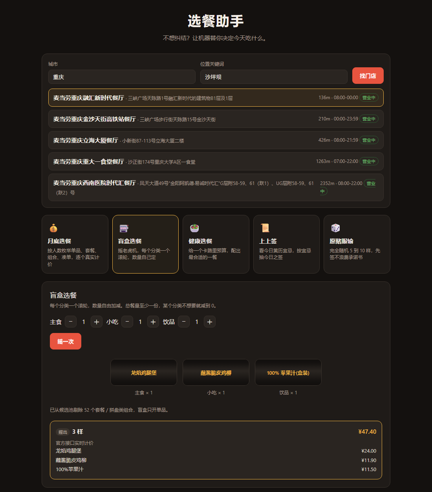

# 选餐助手

基于麦当劳官方 MCP 的点餐决策助手。不帮你查，帮你决定。



## 为什么做这个

麦当劳有一百多个在售餐品，价格、优惠券、营养数据分散在不同接口。你缺的不是信息，是「到底吃哪个」这个决定。

所以这个项目把「怎么做决定」当成产品本身，给了五种方式，按当天心情挑一种。

| 模式 | 什么时候用 | 怎么决定 |
|---|---|---|
| **月底选餐** | 这个月快没钱了 | 枚举单品、套餐、组合、凑单四类候选，每个都走官方接口真实计价，给最省的几套 |
| **盲盒选餐** | 想试试没吃过的 | 摇老虎机，每个分类一个滚轮。只从单品里出，套餐不参与 |
| **健康选餐** | 在控热量 | 给一个卡路里预算，在能查到营养数据的单品里配餐 |
| **上上签** | 想有点仪式感 | 先看今日黄历宜忌，再按宜忌抽签。忌的东西直接不进候选池 |
| **愿赌服输** | 开直播、跟朋友打赌 | 完全随机 5 到 10 样，摇之前先签不浪费承诺书 |

选出结果后可以直接**一键下单**：先看订单预览（门店、取餐方式、商品明细、金额），确认之后才真正创建订单。到店支持堂食和外带，成功后拿到支付链接，扫码或在麦当劳 APP 里付款。项目本身不代付，也不保存任何支付信息。

<p align="center">
  
  
</p>

## 快速开始

需要 Node 18 或更高版本。本项目**零第三方依赖**，不需要 `npm install`。

```bash
git clone <本仓库地址>
cd mcd-picker

# 写入你的 MCP Token
echo "MCD_MCP_TOKEN=你的token" > .env

npm start
```

然后打开 <http://localhost:8787>。

Token 从麦当劳 MCP 官网申请：<https://open.mcd.cn/mcp>。也可以不用 `.env`，直接设环境变量 `MCD_MCP_TOKEN`，环境变量优先。

<details>
<summary>离线看看它长什么样（不消耗额度）</summary>

`tools/` 目录下有若干探测脚本，可以直接跑真实接口看数据结构：

```bash
node tools/smoke.mjs              # 客户端与数据层自检
node tools/test-month.mjs         # 月底选餐：42 个候选真实计价
node tools/test-modes.mjs         # 盲盒与上上签
node tools/test-modes2.mjs        # 健康与愿赌服输
```

</details>

## 项目结构

```
mcd-picker/
├── server/
│   ├── mcp.js          MCP 客户端：串行限速、429 退避重试、TTL 缓存
│   ├── catalog.js      菜单、营养表、门店；含营养表紧凑格式的解析
│   ├── grouping.js     把 14 个菜单分类归成主食 / 小吃 / 饮品
│   ├── random.js       真随机引擎（node:crypto），老虎机抽取
│   ├── almanac.js      黄历：干支、十二建除、点餐宜忌
│   ├── index.js        HTTP 服务与 10 个 API
│   └── modes/          五个模式的实现
├── public/             前端（原生 HTML/CSS/JS，无框架）
├── tools/              探测与测试脚本
└── docs/screenshots/   界面截图
```

## 它和别的点餐工具不一样的地方

### 价格全部实算

每个候选方案都要过一次 `calculate-price`，不用菜单价估算。这不是洁癖：实测 `龙焰美味四件套` 菜单标价 ¥29，裸计价返回 ¥57。

代价是慢，月底选餐要发 42 个计价请求、约 9 秒。换来的是价格可以直接照着下单。

### 券的用法是对的

麦当劳的券不是满减抵扣，而是**绑定专属商品 code 的特价商品**。计价时必须同时传 `couponId` 和 `couponCode`，只传商品 code 会被静默忽略。

另外卡包里的券不等于门店可用券（实测卡包 6 张、该门店可用 2 张），一单只能用一张券。

### 黄历是真算的

上上签的干支和十二建除用标准公式推算，与公开黄历核对一致（2026-10-13 庚申日、开执位）。

宜忌不只是装饰：忌条目会从候选池里剔除商品，宜条目作为抽签优先级。实测「忌油炸 + 忌过甜」把小吃池从 35 个减到 22 个。

### 随机是真随机

盲盒和愿赌服输用 `node:crypto` 而不是 `Math.random`。这是给主播整活用的模式，观众会盯着有没有被算法操控。

## 已知限制

| 限制 | 说明 |
|---|---|
| 营养数据只覆盖单品 | 门店 107 个餐品里只有 49 个能匹配上营养表，套餐不在其中。健康选餐如实标注样本量 |
| 不显示农历月日 | 农历需要朔望月和闰月的天文算法，零依赖做不了。只显示干支和建除，保证显示的每一项都准 |
| 一单只能用一张券 | 错误码 600022。做法是逐张券单独算价取最低 |
| 计价接口较慢 | 候选多的时候要等几秒，界面有等待提示 |
| 限流 600 次/分钟 | 客户端做了 150 毫秒间隔的串行限速和指数退避 |

更细的接口行为记录在 [MCP_INTEGRATION.md](MCP_INTEGRATION.md)。

## 测试

后端有 7 个可直接运行的脚本（见 `tools/`），覆盖客户端层、数据层、五个模式。前端用无头浏览器逐模式渲染验证过。

## 免责声明

本项目为**麦当劳程序员创意开发大赛参赛作品，非麦当劳官方产品**。

餐品、价格与库存以麦当劳官方渠道的实时结果为准。项目输出仅供参考，不构成营养或医疗建议。

本项目不存储、不上传任何用户数据；订单与账户信息仅在调用方本机与麦当劳 MCP 服务端之间传输。
